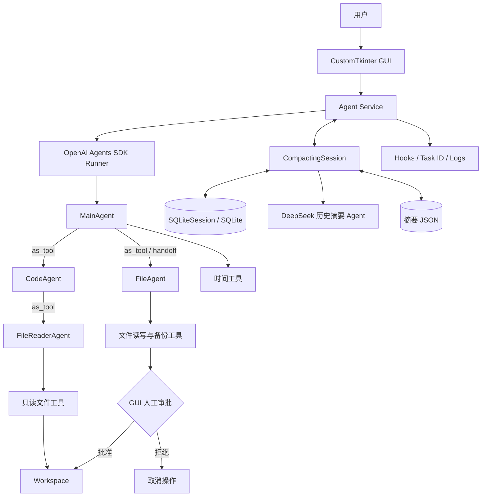
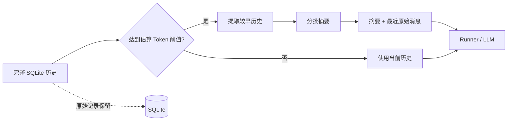

<div align="center">

# ✦ My Agent

### 基于 OpenAI Agents SDK 的通用多 Agent 桌面应用架构

**General-Purpose Agent Framework · Multi-Agent · Desktop GUI · Session Persistence · Human-in-the-Loop**

<p>
  
  
  
  
  
  
</p>

**My Agent** 是一个基于 **OpenAI Agents SDK** 构建的**通用、多 Agent 桌面应用基础架构**，并非面向某个行业的成品 Agent。项目提供多 Agent 编排、工具调用、桌面交互、持久化会话、上下文压缩与操作审批等基础能力，开发者可以在此基础上添加自己的专业 Agent 和工具。

> **当前范围：** 已实现通用聊天、Python 代码辅助、工作区文件管理及相关基础设施。知识库、PLC 编程、工程软件自动化等尚未实现，不属于当前版本功能。

[功能特性](#-核心特性) · [快速开始](#-快速开始) · [项目架构](#-项目架构) · [安全设计](#-安全设计) · [开发路线](#-roadmap)

</div>

> [!NOTE]
> 本项目仍在持续开发中。当前主要面向 Windows + Python 3.11 环境；部分模块、配置方式及依赖版本请以仓库实际代码为准。

## ✨ 核心特性

| 能力 | 说明 |
| --- | --- |
| 🤖 **多 Agent 协作** | MainAgent 负责协调，CodeAgent 负责代码相关任务，FileAgent 负责文件操作，FileReaderAgent 提供只读文件访问能力。 |
| 🧩 **SDK 原生编排** | 优先使用 `Agent`、`Runner`、`handoffs`、`Agent.as_tool()` 和 `function_tool` 等官方能力。 |
| 🖥️ **桌面聊天 GUI** | 基于 CustomTkinter，提供会话列表、消息气泡、输入区域和任务状态反馈。 |
| 📝 **Markdown 展示** | 支持常见 Markdown 文本、标题、列表和代码块渲染；消息文字可选择和复制。 |
| 🧠 **持久化聊天记忆** | 使用 SQLite 支撑的会话存储保存 Agent 对话历史，重新打开应用后仍可继续会话。 |
| 📉 **智能上下文压缩** | 根据估算 Token 预算触发摘要，保留近期原始消息，并将较早历史整理为持久化摘要。 |
| 📂 **工作区文件工具** | 支持查看文件列表、读取文本、写入、追加、列出备份和恢复备份。 |
| 🛡️ **人工审批** | 写入、追加和恢复等操作由桌面界面向用户请求确认。 |
| ♻️ **文件备份** | 对重要文件变更保留备份，支持恢复历史版本。 |
| 📋 **任务日志** | 记录 Task ID、Agent 执行、工具调用、交接和任务耗时，便于排查问题。 |
| ⚡ **异步执行** | 在后台 asyncio 事件循环中运行 Agent，主线程负责桌面界面更新。 |

## 🏗️ 项目架构



### Agent 分工

- **MainAgent**：接收用户请求、选择工具并协调专业 Agent。
- **CodeAgent**：处理 Python 代码分析与编程相关问题；需要文件内容时调用只读文件专家。
- **FileReaderAgent**：负责列出和读取工作区文件，不承担写入操作。
- **FileAgent**：负责工作区文件管理；涉及修改时遵循审批流程。

这种设计将“理解需求”“分析代码”和“修改文件”分开，降低不同职责混在一个 Agent 中的复杂度。

## 🚀 快速开始

### 1. 环境要求

- Windows（当前主要开发与测试环境）
- Python **3.11**（建议使用与项目开发环境一致的版本）
- 可用的 DeepSeek API Key
- Git（用于克隆仓库）

### 2. 克隆项目

```bash
git clone https://github.com/huahaizo/myagent.git
cd myagent
```


### 3. 创建虚拟环境

**Windows PowerShell**：

```powershell
python -m venv .venv
.\.venv\Scripts\Activate.ps1
```

**Windows CMD**：

```bat
python -m venv .venv
.venv\Scripts\activate.bat
```

### 4. 安装依赖

使用仓库中的 `requirements.txt` 安装依赖：

```bash
pip install -r requirements.txt
```

当前项目的主要依赖包括：

- `openai-agents`
- `openai`
- `customtkinter`
- `markdown-it-py`
- `python-dotenv`（读取 `.env` 环境配置）

> 建议将已经测试通过的依赖版本写入 `requirements.txt`，不要直接使用未经验证的最新版依赖替代当前运行环境。

### 5. 配置 API Key

**不要将真实 API Key 写进 Git 仓库。**

仓库提供不含密钥的 `.env.example` 模板。将其复制为 `.env`：

**Windows PowerShell**：

```powershell
Copy-Item .env.example .env
```

编辑 `.env`，填写你自己的 DeepSeek API Key：

```dotenv
api_key=sk-your-own-deepseek-key
```

当前 `config.py` 使用 `os.getenv("api_key")` 读取此变量，变量名必须保持一致。不要把真实密钥提交到 GitHub。运行需要可用的模型 API 网络连接。

### 6. 启动桌面应用

```bash
python run_ui.py
```

启动后即可在 GUI 中创建聊天、发送消息，并根据 Agent 请求批准或拒绝文件操作。

## 🗂️ 项目结构

以下是当前项目的主要模块示意；实际文件可能随开发持续调整。

```text
openaiagent/
├── .env.example                 # 环境变量示例（可提交）
├── .gitignore                   # 排除密钥和本地数据
├── requirements.txt             # Python 依赖
├── README.md                    # 项目说明
├── run_ui.py                    # 桌面程序入口
├── config.py                    # 模型客户端与配置
├── agent_service.py             # Agent 运行服务
├── chat_manager.py              # GUI 聊天会话管理
├── multi_agents/
│   ├── main_agent.py            # 主协调 Agent
│   ├── code_agent.py            # 代码 Agent
│   ├── file_agent.py            # 文件 Agent
│   └── file_reader_agent.py     # 只读文件 Agent
├── tools/
│   ├── file_tools.py            # 文件工具、审批与备份
│   ├── time_tools.py            # 时间工具
│   └── math_tools.py            # 数学工具
├── ui/
│   ├── chat_window.py           # 主窗口及事件处理
│   ├── chat_area.py             # 消息列表与气泡
│   ├── input_area.py            # 输入区域
│   ├── markdown_renderer.py     # Markdown 渲染
│   └── theme.py                 # UI 主题
├── utils/
│   ├── agent_hooks.py           # SDK Hooks
│   ├── task_context.py          # Task ID 上下文
│   ├── logger.py                # 日志管理
│   ├── agent_context.py         # Agent 上下文
│   ├── compacting_session.py    # 压缩会话包装器
│   └── logger.py                # 日志管理
├── workspace/                   # 工作区文件（本地数据）
├── history/                     # SQLite 历史与摘要（本地数据）
└── logs/                        # 运行日志（本地数据）
```

## 🧠 记忆与上下文压缩

My Agent 将**原始聊天存储**与**发送给模型的有效上下文**分离：

1. `SQLiteSession` 保存完整的 Agent 聊天历史。
2. `CompactingSession` 在运行前估算当前历史的 Token 消耗。
3. 达到配置阈值时，使用摘要 Agent 分批整理较早历史。
4. 发送给模型的上下文由**历史摘要 + 最近原始消息**组成。
5. 摘要写入本地 JSON，并通过历史前缀指纹检查是否仍然适用。
6. 摘要失败时尽量回退到已有历史，不删除原始 SQLite 记录。



> [!IMPORTANT]
> Token 估算不是 DeepSeek 官方 tokenizer 的精确计数；当前预算主要针对历史消息，不代表模型完整上下文窗口。摘要也可能遗漏细节，因此不应把摘要当作文件内容、代码或操作记录的唯一可信来源。

## 🔐 安全设计

My Agent 在文件操作中采用**工作区约束 + 人工确认 + 备份**的应用层安全思路：

- **只读职责分离**：CodeAgent 可通过 FileReaderAgent 获取文件内容，而不是直接拥有写入能力。
- **高影响操作审批**：创建、追加和恢复文件等操作需要用户在 GUI 中确认。
- **备份与恢复**：为文件修改提供可回退的路径。
- **日志可追踪**：记录任务执行过程，便于定位异常。
- **隐私保护**：聊天历史、摘要、日志和密钥默认应留在本地，不提交到公开仓库。

> [!WARNING]
> 工作区路径限制和 GUI 审批**不等于操作系统级沙箱**。当前项目不应被视为具备隔离运行不可信代码的能力。未来如果加入终端命令、Python 代码执行或自动操作工程软件，需要额外的权限与隔离设计。

### GitHub 发布前检查

建议 `.gitignore` 至少包含：

```gitignore
# Secrets
.env
.env.*
!.env.example

# Python
__pycache__/
*.py[cod]
.venv/
venv/
.idea/
.pytest_cache/

# Local runtime data
history/
logs/
workspace/
*.db
*.db-shm
*.db-wal

# OS
.DS_Store
Thumbs.db
```

如果你准备发布示例工作区文件，请单独建立 `examples/`，不要直接公开个人 `workspace/` 内容。若密钥曾被提交到 Git 历史，**仅新增 `.gitignore` 不够**，还应撤销并重新生成密钥，并处理历史中的泄露内容。

## 🧰 技术栈

| 层次 | 技术 |
| --- | --- |
| 编程语言 | Python 3.11 |
| Agent 编排 | OpenAI Agents SDK |
| 模型接口 | DeepSeek（OpenAI 兼容 Chat Completions） |
| GUI | CustomTkinter + Tkinter |
| 聊天持久化 | SQLite / `SQLiteSession` |
| 上下文管理 | 应用层摘要压缩 Session |
| Markdown | markdown-it-py + Tkinter Text |
| 异步任务 | asyncio + threading + queue |
| 日志 | Python logging / RotatingFileHandler |

## 🧱 如何基于本架构扩展

这个仓库提供的是通用 Agent 应用基础设施。新增专业能力时，通常只需要：

1. 在 `tools/` 中编写受控的 `@function_tool` 工具。
2. 在 `multi_agents/` 中定义具有明确职责的 Agent。
3. 在 `MainAgent` 中通过 `Agent.as_tool()` 或适当的 handoff 接入。
4. 在 `ui/` 中按需增加交互入口，并为高影响操作保留审批。
5. 添加测试、日志和失败处理，避免将模型输出直接视为已执行结果。

**可扩展方向（非当前功能）**：本地 RAG 知识库、文档处理、PLC 编程辅助、工程软件仿真集成等。

## 🗺️ Roadmap

- [x] 基础桌面聊天 GUI
- [x] DeepSeek 模型接入
- [x] MainAgent 与专业 Agent 协作
- [x] SDK 原生工具与 Agent-as-tool 编排
- [x] SQLite 持久化会话
- [x] Markdown 消息渲染
- [x] 工作区文件读写工具
- [x] 文件写入审批与备份恢复
- [x] Task ID、Hooks 与运行日志
- [x] 基础 Token 预算触发的历史摘要压缩
- [ ] 更精确的 Token 统计与完整上下文预算
- [ ] 复杂工具调用历史的压缩一致性测试
- [ ] 同一会话的并发保护与自动化测试
- [ ] `.env.example`、依赖锁定与一键安装完善
- [ ] 更完善的工具权限与安全隔离
- [ ] 可插拔工具和专业 Agent 示例
- [ ] 本地 ChromaDB / RAG 知识库（可选扩展）

## 🤝 参与贡献

欢迎通过 Issues 提交问题与建议，或通过 Pull Requests 改进代码、文档和测试。

建议贡献流程：

1. Fork 仓库并创建功能分支。
2. 尽量保持改动聚焦，并说明原因。
3. 为关键行为补充测试或复现步骤。
4. 确认没有提交 API Key、聊天记录、日志或个人工作区文件。
5. 提交 Pull Request，描述变更内容及验证结果。

## ❓ 常见问题

<details>
<summary><strong>为什么不直接把所有能力写进一个 Agent？</strong></summary>

不同 Agent 负责不同职责，更容易限制工具权限、维护提示词和观察执行过程。My Agent 使用 SDK 原生的 `as_tool()` 与 `handoffs` 进行编排。

</details>

<details>
<summary><strong>为什么聊天历史保存在 SQLite 中，还需要上下文压缩？</strong></summary>

SQLite 解决的是持久保存问题，而模型一次请求能够处理的上下文是有限的。压缩通过摘要旧历史来控制发送给模型的内容长度，两者解决的是不同问题。

</details>

<details>
<summary><strong>文件操作是否完全安全？</strong></summary>

目前提供应用层的目录约束、人工审批与备份机制，但不是系统级沙箱。对于自动执行代码、安装依赖或操作外部工程软件，需要额外的安全措施。

</details>

<details>
<summary><strong>能否替换为其他大模型？</strong></summary>

项目基于 OpenAI Agents SDK 的模型抽象构建，理论上可以适配其他兼容模型接口；但不同提供商对工具调用、消息格式和模型能力的支持不同，替换前需要实际测试。

</details>


<div align="center">

**✦ My Agent — 一个可继续扩展的 OpenAI Agents SDK 多 Agent 桌面应用基础架构。**

如果这个项目对你有帮助，欢迎在 GitHub 上留下一个 ⭐ Star。

</div>
